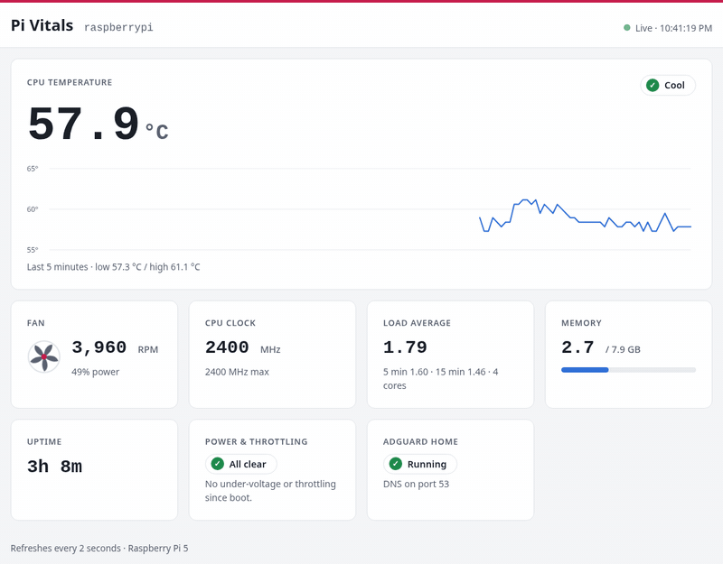

<p align="center">
  <h3 align="center">Pi Vitals</h3>

  <p align="center">A live dashboard that displays data about my Raspberry Pi 5</p>

  <p align="center">Not deployed to the public - for my home network</p>
</p>

<p align="center">
  
</p>

## About The Project

### Why this exists:
I ordered & received a Raspberry Pi 5 (8GB) running Raspberry Pi OS. I had Claude assist me with updates & setting up my dev environment. 
Afterwards I gave Claude a gift, and granted full access to the pi. Claude setup AdGuard Home & built Pi-vitals.
I used the /loop command overnight and woke up to several new projects/changes. I asked for feedback on how we can improve our next /loop session. I’m excited to see how /loop & gathering a team of agents can change our workflow.

Pi Vitals is the first project built on the Pi itself. It's a small Express app that reads the Pi's own hardware sensors and shows them on a live dashboard I can open from any device on my home network.

## How It Works

### Features
* CPU temperature with a Cool / Warm / Hot status and a history graph for the last 5 minutes, hour, or 24 hours (hover for exact readings; gaps show where readings are missing, for example while the Pi was off)
* Fan speed in RPM and % power, with an animated fan icon that spins faster as the real fan speeds up
* CPU clock speed, load average, and memory use (plus swap), with uptime next to the hostname
* Storage: space used and free on the SD card, counted the same way as `df -h`; the bar turns amber at 80% full and red at 90%
* Power & throttling check: warns about under-voltage or thermal throttling, right now or since boot
* Last restart: when the Pi started, and whether the run before it shut down normally or just stopped (a freeze, crash or power cut), with how long it was down
* AdGuard Home check: shows whether AdGuard is actually answering DNS lookups, not just running, and how long a test lookup took
* Wi-Fi card: signal strength (dBm and link quality) plus live download and upload speeds
* What's using the CPU: the top 5 programs by current CPU use, with memory, grouped by name (like a mini `top`)
* Refreshes every 2 seconds, and stops while the tab is hidden, so the Pi isn't doing work nobody sees
* Light and dark mode, and a layout that works on phones
* Respects reduced-motion settings (the fan and live indicator stop animating)

### Technologies


### Full Breakdown

**Where the data comes from**

Everything is read straight from the Pi. No database, no outside services, and nothing needs sudo.

| Stat | Source |
|---|---|
| CPU temperature | `/sys/class/thermal/thermal_zone0/temp` |
| Fan RPM and power | `/sys/devices/platform/cooling_fan/hwmon/*/fan1_input` and `pwm1` |
| CPU clock | `/sys/devices/system/cpu/cpu0/cpufreq/scaling_cur_freq` |
| Memory and swap | `/proc/meminfo` |
| Storage | `statfs` on `/` (Node's `fs.statfs`), plus `/proc/self/mounts` to tell an SD card from an SSD |
| Load and uptime | Node's built-in `os` module |
| Power & throttling | `vcgencmd get_throttled` |
| Last restart | `journalctl --list-boots` and the previous boot's "Journal stopped" entry, plus the Pi 5's `/proc/device-tree/chosen/power/power_reset` |
| AdGuard Home | `systemctl is-active AdGuardHome`, plus a test lookup of `example.com` sent to AdGuard at `127.0.0.1` |
| Wi-Fi signal and speeds | `/proc/net/wireless` and `/proc/net/dev` |
| Top programs | `/proc/<pid>/stat`, compared between polls (page size and clock ticks from `getconf`) |

**How the pieces fit**

```
server.js                       Express setup: helmet, morgan, static files, 404 and error handlers
routes/vitalsRoutes.js          GET /  (the dashboard),  GET /api/vitals  and  GET /api/history  (JSON)
controller/vitalsController.js  Reads every sensor in parallel and returns one JSON object (parsers kept separate so tests can feed them text)
controller/historyController.js Records the CPU temperature, memory and swap every 2s and keeps a day of minute averages
views/dashboard.ejs             Dashboard markup
views/error.ejs                 404 / error page
public/js/main.js               Polls /api/vitals every 2s and updates the page and graph
public/css/styles.css           All styles, light and dark mode
```

The browser asks `/api/vitals` for fresh numbers every 2 seconds while the tab is visible, and asks again as soon as you come back to it. The server reads the sensors and sends back JSON. The page then updates the numbers, redraws the temperature graph (an SVG built with plain JavaScript), and adjusts the fan animation speed. When the page opens, and when you come back to its tab, it also fetches `/api/history`, so the chart starts out full instead of empty.

**History**

The server records the CPU temperature and how much memory and swap are in use every 2 seconds, whether or not the dashboard is open. It keeps the last 5 minutes of those readings for the 5-minute charts, and one average per minute for the last 24 hours for the hour and day charts.

The minute averages are saved to `data/history.json` every 10 minutes and whenever the service stops, so restarts and reboots keep the last day. A power cut or freeze loses at most the last 10 minutes. The file is about 100 KB and is gitignored. If it's ever damaged, the server logs that and starts a fresh history. Minutes saved before memory was recorded (before Oct 14 2026) only have a temperature.

**The AdGuard check**

A running service doesn't prove DNS works: AdGuard stays "active" even when its upstream DNS server times out. So once a minute, the server asks AdGuard to look up `example.com`, a domain reserved for testing that no block list includes. Polls in between reuse that result.

| Card shows | Meaning |
|---|---|
| Answering | The test lookup got an answer in under 1 second |
| Slow | It got an answer, but took 1 second or more |
| Not answering | The service is running, but the lookup failed or got no answer within 2 seconds |
| Not running | The AdGuardHome service is stopped |

The test lookups appear in AdGuard's query log as `example.com` from `127.0.0.1`, about once a minute while the dashboard is open. They never count as blocked. To hide them, add `example.com` to the ignored domains for the query log and statistics in AdGuard's Settings → General settings.

**The Last restart card**

When the Pi shuts down or reboots on purpose, the system log's last line for that run is journald saying "Journal stopped". When it freezes, crashes or loses power, the log just stops. So when the server starts, it finds the run before this one in `journalctl --list-boots` and checks whether "Journal stopped" came at the end of it (within 30 seconds). This only works if the system log is kept on disk; Raspberry Pi OS keeps it in RAM by default, where it's lost at every restart. To keep it on disk, create `/etc/systemd/journald.conf.d/50-persistent.conf` (with sudo) containing `[Journal]` and `Storage=persistent` on separate lines, then run `sudo systemctl restart systemd-journald`.

| Card shows | Meaning |
|---|---|
| Clean restart | The previous run shut down normally |
| Unexpected stop | The previous run's log stopped without a shutdown; the card says when and how long the Pi was down |
| No earlier start | The log begins with the current run, so there's nothing to compare yet |
| Power chip reset | The Pi 5's power chip (PMIC) reset itself, for example from under-voltage or overheating |

Reading the system log needs the `adm` group, which the Pi's default user is in. It's read once when the server starts, since none of it changes until the next boot.

**Why it isn't hosted online**

The app reads the hardware of the machine it runs on, so it has to run on the Pi. 

**Running it**

```bash
npm install
npm start
```

Then open http://127.0.0.1:3141 on the Pi.

To open it from other devices on the home network, create a `.env` file:

```
HOST=0.0.0.0
PORT=3141
```

and visit `http://<pi-ip-address>:3141`.

`HISTORY_FILE` in `.env` moves the temperature history somewhere other than `data/history.json`.

**Tests**

```bash
npm test
```

Uses Node's built-in test runner, so there's nothing extra to install. It takes about 2 seconds and reads the Pi's real sensors, so run it on the Pi.

`test/parsersTest.js` feeds the sensor parsers sample text, including the awkward cases: program names with spaces or a `)` in them, several throttling flags at once, no Wi-Fi link, a byte counter that runs into the colon, a disk reading that must round up the way `df` does, and a journald restart an hour before a freeze (which must not count as a clean shutdown).

`test/serverTest.js` starts the real `server.js` on a free port and checks over HTTP:

- the dashboard page, its security headers, and the 404 page
- `/api/vitals`: every stat is present and believable, and the busiest programs appear from the second poll on
- `/api/history`: a reading (temperature, memory and swap) is taken as soon as the server starts
- the history file: readings older than 24 hours and broken ones are skipped on load, minutes saved before memory was recorded still load, it's saved again when the server gets SIGTERM (as `systemctl` sends), and a damaged file is replaced with a fresh history

Each test server keeps its history in a temp folder (through `HISTORY_FILE`), so running the tests never touches the dashboard's own `data/history.json`, even while the service is running.

**Starting it at boot**

`deploy/pi-vitals.service` is a systemd *user* service: it runs as you, not root, and restarts itself if it crashes. It loads Node through nvm, so it keeps working if your default Node version changes.

```bash
mkdir -p ~/.config/systemd/user
cp deploy/pi-vitals.service ~/.config/systemd/user/
systemctl --user daemon-reload
systemctl --user enable --now pi-vitals
loginctl enable-linger "$USER"   # start at boot even before anyone logs in
```

Handy commands: `systemctl --user status pi-vitals`, `systemctl --user restart pi-vitals` (after changing `.env` or pulling updates), and `journalctl --user -u pi-vitals -f` for logs. While the service is running, it holds port 3141, so stop it before running `npm start` by hand.

